 

I'm a B.Tech student in Computing and Data Science at Sai University (graduating May 2027), interested in building AI systems that work reliably in the real world.

In summer 2026 at Altrosyn, I worked on a multi-agent hiring pipeline in LangGraph, from resume parsing to interview scheduling. Alongside coursework, I build projects in RAG and agentic AI, and I'm also curious about computer vision and system design.

I'm looking for AI/ML internships and roles where I can keep learning by building.

- **Education:** B.Tech, Computing and Data Science, Sai University, Chennai · 2023 to 2027 · CGPA 8.33/10
- **Exploring:** computer vision and system design
- **Ask me about:** LangGraph, multi-agent systems, RAG, FastAPI

## Highlights

- **AI/ML Intern, Altrosyn** (June to July 2026). Architected a nine-agent autonomous hiring pipeline in LangGraph with a central supervisor and typed shared state. Built a resume-parsing agent (~90% field-level F1) and a semantic screening agent (~80% Precision@5), plus fairness safeguards that reached ~0.70 weighted κ agreement between AI and human evaluators.
- **Research, 2024.** Co-authored *A Red Team AI Simulation: Adversarial Scenario on Bioweapons* with Sai University's Pugwash chapter (mentor: Tyler Peppel, NYU), probing whether GPT-3.5/4.0 could be coerced into bioweapon-related assistance. Findings were shared with OpenAI. [Publication](https://drive.google.com/file/d/1erC4NRkOYhAnNznwgme07qhZWXAKiSlB/view) · [Feature](https://www.the-trebuchet.org/sai-university)

## Selected projects

**[Agentic Legal Intelligence Platform](https://github.com/NayanaReddyK/Agentic-legal-intellligence-platform)**
Contract review with grounded citations. Parses PDF, DOCX and TXT contracts, extracts clauses, and flags risks with an LLM, then checks each finding against retrieved statutes using hybrid BM25 and BGE retrieval. Lawyers can accept, edit or reject findings, and every decision is audit-logged.
Results: 93.1% clause-extraction precision and 85.3% risk-detection F1 (66.5% for an LLM-only baseline); citation support up from 70.8% to 86.4% over an LLM + RAG baseline.
`Python` `FastAPI` `React` `ChromaDB` `Sentence Transformers (BGE)` `Rank-BM25` `SQLite` `PyMuPDF` `OCR`

**[DevFlow](https://github.com/NayanaReddyK/DevFlow)** · [Live demo](https://devflow-f.onrender.com)
A dependency-aware project tracker with workspaces, role-based access and a real-time Kanban board. A rule-based module flags bottleneck tasks, stale blockers and overdue risk, with evidence for every finding. Includes cycle prevention, downstream-impact counting and critical-path computation.
Results: 145 automated tests; ~90 ms p95 latency on the insights endpoint with 500 tasks and 300 dependencies.
`Django` `DRF` `Django Channels` `PostgreSQL` `React` `TypeScript` `Docker`

**[Autonomous AI Shopping Agent](https://github.com/NayanaReddyK/AI_Shoppping_Agent)**
A price-intelligence engine for Indian e-commerce. An MCP-based agent scrapes product pages with layered fallbacks, and Gemini with Google Search Grounding compares live prices across platforms with median-based outlier filtering.
Results: ~95% price-extraction accuracy; ~88% faster repeat lookups (3.6 s to 0.42 s) with a 1-hour URL cache.
`Python` `FastAPI` `MongoDB Atlas` `Groq LLaMA-3` `Gemini` `MCP`

**[Clinical NER](https://github.com/NayanaReddyK/clinical-ner)**
A course project: a BiLSTM-CRF pipeline in PyTorch that extracts diseases, drugs and dosages from clinical notes, with a Gradio demo. A proof of concept trained on a small synthetic dataset.
`Python` `PyTorch` `NLTK` `spaCy` `Gradio`

## Skills

**Languages** `Python` `SQL` `C` `C++`

**Agentic AI and LLMs** `LangChain` `LangGraph` `Multi-agent orchestration` `Hybrid RAG` `MCP` `Pydantic` `Gemini (Search Grounding)` `Sentence Transformers (BGE)` `Rank-BM25`

**ML and NLP** `PyTorch` `NLTK` `spaCy` `scikit-learn` `Gradio`

**Full-stack and databases** `React` `FastAPI` `REST APIs` `Django` `DRF` `JWT` `PostgreSQL` `Supabase (pgvector)` `MongoDB Atlas` `ChromaDB` `SQLite` `Pytest`

**Cloud and MLOps** `AWS (EC2, S3)` `Docker` `Kubernetes` `DVC` `Git` `GitHub`

## Contribution activity

Live contribution graph from my public GitHub activity, rendered by <a href="https://ghchart.rshah.org">ghchart.rshah.org</a>.

## Find me

[LinkedIn](https://www.linkedin.com/in/nayana-reddy-k/)

 

